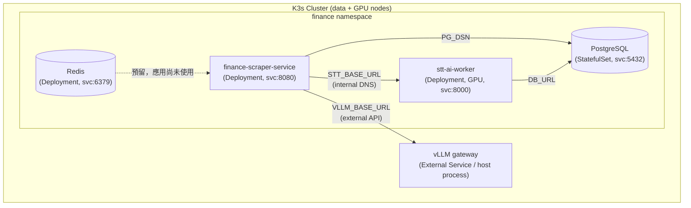

# ai-finance-infra

> Home lab 上跑的 AI 金融知識引擎 — 編排層。法說會 / podcast / YouTube 等金融多媒體 → STT → LLM 摘要 → 結構化資料層,所有架構決策都從硬體約束反推。

這個 repo **本身不寫業務邏輯**,職責是用 Kubernetes (K3s) 把幾個獨立服務、共享資料層接在一起。原有的 `docker-compose` 則退居本地開發與快速測試用。

---

## 系統定位

3 個 repo 各司其職:

| Repo | 角色 | 語言/技術 |
|---|---|---|
| **ai-finance-infra** (本 repo) | 編排層 — docker-compose / K3s manifests、共享 PG/Redis、自動部署機制 | Docker Compose / K8s YAML |
| [`finance-scraper-service`](https://github.com/pei9564/finance-scraper-service) | 收外部來源 → 經 LLM gateway 翻譯/摘要 → 寫入 PG | Python / FastAPI |
| [`stt-ai-worker`](https://github.com/pei9564/stt-ai-worker) | 音訊轉逐字稿 (Podcast / YouTube),faster-whisper GPU 推論 | Python / FastAPI |

使用流程：`collect → 按需求 STT → 手動 translate / summarize`，收集時另產生跨來源日報摘要。scraper 是 IO 為主,STT 是 GPU 為主,scraper 透過 HTTP 提交 STT 任務並輪詢結果，PG 儲存事件、任務與逐字稿。Redis 目前未被應用使用，保留作為未來擴充。

切成 3 repo 的理由:
- **執行特性差異** — scraper IO 重 (API + httpx + DB),STT GPU 重 (VRAM ~6 GB),image 大小、scaling 策略、CI 都不同
- **infra 是黏著層** — 改部署不用動業務 code,反之亦然
- **infra repo 作為編排核心** — 集中管理架構設定與部署配置
<!-- - **infra repo 同時當 hub** — `docs/` 放跨專案 narrative、ADR、4 節點落位互動 demo,進站先看這裡再選擇深入哪個 repo -->

---

## 元件拓樸



關鍵設計選擇:
- **Compose 的 PG / Redis 不貼 watchtower label** — 自動更新只動 scraper/stt 的 application image,stateful 服務手動升級
- **vLLM 跑在 host 而非 compose 內** — GPU 直通效率較高、模型權重重啟成本大;`host.docker.internal` 從容器連回 host
- **scraper 透過 STT HTTP API 整合** — 提交任務後輪詢結果，STT 自己管理任務與逐字稿；scraper 將結果寫回事件正文
- **STT 任務持久化** — PG 保存來源描述；單一 worker 使用程序內佇列，重啟時從 PG 恢復未完成任務；上傳音檔保存於 volume / PVC

---

## Port 對應

主機同時跑其他專案,host port 全部避讓:

| Service | 容器內 | Host | 避讓對象 |
|---|---|---|---|
| Redis | 6379 | **6380** | 其他專案佔的 6379 |
| PostgreSQL | 5432 | **5433** | 其他專案佔的 5432 |
| scraper | 8080 | **8080** (`SCRAPER_PORT` 可改) | — |
| stt | 8000 | **8001** | scraper 佔的 8000 |

---

## 部署

> Image 目前置於 GHCR。完整跑起來需要相對應的環境變數與 credential；若只需了解架構，閱讀本 README 與 `docker-compose.yml` 即可。

前置:
- Docker + Docker Compose v2
- NVIDIA Container Toolkit (若 STT 走 `STT_DEVICE=cuda`)
- `docker login ghcr.io` (拉 private image 必要)

```bash
cd ai-finance-infra
make init       # 已有 .env 時不覆寫
# 編輯 .env：POSTGRES_PASSWORD、GITHUB_TOKEN、LLM endpoint / model / API key
make login      # private GHCR image 才需要，登入提示時貼上可讀 packages 的 PAT
make up         # 拉已發布 image，啟動 PostgreSQL、Redis、scraper、STT
```

預設 `MODE=registry DEVICE=cuda`。`make up` 會拉取 `.env` 的 `SCRAPER_IMAGE` / `STT_IMAGE`，並更新 image 已改變的 container。Makefile 的 `DEVICE` 決定 STT 裝置，優先於 `.env` 的 `STT_DEVICE`；CPU 啟動用 `make up DEVICE=cpu`，同時移除 NVIDIA device reservation。

入口：scraper <http://localhost:8080>（可用 `SCRAPER_PORT` 調整），STT <http://localhost:8001>。首次載入 Whisper 會下載模型，請用 `make logs` 查看進度。

LLM gateway 維持外部服務，由 `.env` 的 `VLLM_BASE_URL` 連接本地 vLLM 或雲端相容 API；`make up` 不會啟動模型 gateway。

| 指令 | 用途 |
|---|---|
| `make help` | 列出所有指令 |
| `make images` | 查看選用 image 名稱，不顯示 credentials |
| `make update` | 拉取 image 並套用更新 |
| `make ps` / `make logs` | 查看服務狀態 / 持續追蹤 log |
| `make down` | 關閉服務，保留 PG 與上傳音檔 volumes |
| `make config` | 驗證 Compose 設定，不輸出 secrets |
| `make auto-update` | 額外啟動 Watchtower（需 Docker registry 登入資訊） |
| `make e2e-setup` / `make e2e` | 安裝 / 執行隔離的 Playwright 測試 |

Watchtower 預設不由 `make up` 啟動；要自動更新才另外執行 `make auto-update`。Redis 雖尚未被應用使用，仍隨核心服務啟動。

### Image registry

兩個 application repo 的 `.github/workflows/docker-publish.yml` 已設定 GitHub Container Registry（GHCR）：

- `ghcr.io/pei9564/finance-scraper-service:latest`
- `ghcr.io/pei9564/stt-ai-worker:latest`

可在 [GitHub Packages](https://github.com/pei9564?tab=packages) 查看已發布的 package 與版本。這裡是 CI 設定的目標；本地 commit 尚未 push 時，registry 不會含有那些修正。

推送 application repo 的 `main` 並通過 CI 後會 build / push `latest`，也產生 `sha-<短 SHA>` tag；`v*.*.*` tag 會產生對應版本 image。infra repo 管部署，沒有自己的 application image。

### 本地程式與開發模式

三個 repo 在同層時，可直接 build 目前程式，不必先 push 或登入 GHCR：

```bash
make up MODE=local              # build 兩個 application，再啟動整套
make up MODE=local DEVICE=cpu   # CPU 模式
make up MODE=dev DEVICE=cpu     # 另掛載 scraper src/config 與 STT app，開 reload
```

local / dev image 使用本地 tag，Watchtower label 關閉。後續的 `logs`、`ps`、`down` 等指令請帶相同的 `MODE` / `DEVICE`。`make build` 可單獨 build 本地 application image。Makefile 以自身所在目錄解析路徑，支援 `make -C /path/to/ai-finance-infra ...`。

---

## Compose 自動部署 (watchtower)

此機制只適用 Compose；K3s 不會由 watchtower 更新。K3s 更新請修改 overlay 的固定 image tag，再執行 `make k8s-diff`／`make k8s-deploy`。

scraper 與 stt 兩個 service 貼了 `com.centurylinklabs.watchtower.enable=true` label。流程:

1. 兩個 application repo 各自 CI build image → push `:latest` 到 GHCR
2. watchtower 每 30 秒問 GHCR 一次有沒有新 digest
3. 有 → `docker pull` → 重啟對應 container → 清舊 image

DB / Redis **沒貼 label**,不會被動;要 pin 版本就把 `.env` 的 image tag 從 `:latest` 改成 `:sha-xxxxxxx`,watchtower 不會升 (因為 tag 不變)。

---

## K3s／Kustomize：實際執行流程

以下部署的是兩台電腦組成的同一個叢集：A 跑 PostgreSQL／scraper，B 跑 GPU STT。
**應用部署只在一台管理電腦執行一次，不需要兩台各跑一次 Makefile。**
管理電腦可以是 A，也可以是加入相同 Tailscale tailnet 的筆電。
`make up` 啟動的是 Docker Compose；K3s 請使用 `make k8s-deploy`。

### 1. 先確認 K3s 是否已建立

- **還沒安裝 K3s，或 B 還沒加入**：先完成 [K3s＋Tailscale 兩節點安裝](docs/k3s-tailscale-setup.md)，再回到下面步驟。
- **已經有 K3s**：使用現有 kubeconfig，確認兩台節點 Ready，且 B 已安裝 NVIDIA runtime／device plugin。
- **原本已有資料**：先依 [遷移說明](docs/k3s-setup-draft.md) 備份與還原；不要把以下首次部署流程當作資料搬移工具。

以下指令在管理電腦執行，工作目錄是 `ai-finance-infra`：

```bash
cd ai-finance-infra
```

若管理電腦就是 A，可先複製 K3s 的管理設定，不必放寬原檔權限：

```bash
mkdir -p "$HOME/.kube"
sudo install -m 600 -o "$(id -u)" -g "$(id -g)" \
  /etc/rancher/k3s/k3s.yaml "$HOME/.kube/finance-k3s.yaml"
```

這個複製指令會覆寫目的檔，僅用於第一次建立該 kubeconfig。
遠端管理電腦請依安裝文件安全取得 kubeconfig，並將 API 位址改為 A 的 Tailscale IP。
已有個人 kubeconfig 可跳過複製。準備好後再設定路徑與檢查叢集：

```bash
# 改成自己的 kubeconfig 路徑；後續 kubectl 和 make 都使用這份設定
export KUBECONFIG="$HOME/.kube/finance-k3s.yaml"
kubectl config current-context
kubectl get nodes -o wide
kubectl get storageclass local-path
kubectl get runtimeclass nvidia
```

看到 `permission denied /etc/rancher/k3s/k3s.yaml` 時，使用上述個人副本及 `KUBECONFIG`。

### 2. 指定 A／B 的工作角色

先用 `kubectl get nodes` 查實際節點名稱。若依安裝文件建立，名稱就是 finance-data／finance-gpu：

```bash
kubectl label node finance-data finance.node/role=data --overwrite
kubectl label node finance-gpu finance.node/role=gpu --overwrite
kubectl get nodes -L finance.node/role
kubectl get node finance-gpu -o jsonpath='{.status.allocatable.nvidia\.com/gpu}{"\n"}'
```

如果名稱不同，替換上述兩個名稱。最後一個指令應顯示至少 `1`；
空白代表 GPU 尚未被 device plugin 提供。B 的驅動／Toolkit 與 NVIDIA runtime 就緒後，
先執行 `make k8s-gpu-render`／`make k8s-gpu-install` 安裝固定 v0.20.1，再查 GPU 數量。
完整安裝條件與來源見 [GPU addon 文件](k8s/addons/nvidia-device-plugin/README.md)。

### 3. 建立應用 Secrets

K3s 使用 Kubernetes Secrets，**不會讀取 Compose 的 `.env`**。

```bash
kubectl apply -f k8s/base/namespace.yaml
test -f k8s/secrets.yaml || cp k8s/secrets.yaml.example k8s/secrets.yaml
nano k8s/secrets.yaml
```

填入 `POSTGRES_USER`、`POSTGRES_PASSWORD`、`POSTGRES_DB`、`GITHUB_TOKEN`、`VLLM_API_KEY`，
移除範本 credentials，存檔後套用：

```bash
kubectl apply -f k8s/secrets.yaml
```

預設 LLM 是 Gemini 相容 API；使用本地 vLLM 時，依 [環境調整說明](k8s/README.md#環境調整)
修改 endpoint／model。真實 `secrets.yaml` 已被 Git 忽略。

### 4. 讓叢集能拉 GHCR images

本機的 `make login`／`docker login` 不會自動讓 K3s 登入。
使用具有讀取對應 packages 權限的 PAT，在管理電腦建立專用 pull Secret：

```bash
registry_config=$(mktemp -d)
docker --config "$registry_config" login ghcr.io --username pei9564
# 登入成功後再繼續；提示 Password 時輸入 PAT
kubectl -n finance create secret generic ghcr-cred \
  --type=kubernetes.io/dockerconfigjson \
  --from-file=.dockerconfigjson="$registry_config/config.json" \
  --dry-run=client -o yaml | kubectl apply -f -
rm -rf "$registry_config"
```

這一步需要管理電腦有 Docker CLI。若 Docker config 使用 credential helper，
請依 [pull Secret 說明](k8s/README.md#前置設定) 處理完整的 registry credential。

### 5. 選定版本、預覽並部署

從 [GitHub Packages](https://github.com/pei9564?tab=packages) 查兩個 app 已發布的版本，
目前兩個 overlay 已固定 scraper `sha-036e8ec`、STT `sha-c3ba002`。
這是本地修正版的目標版本；查詢 GHCR 尚未取得這兩個 manifests。先發布它們，
或編輯以下檔案的兩個 `images[].newTag`，指定其他已發布且包含所需修正的 `sha-...` tag：

```bash
nano k8s/overlays/homelab/kustomization.yaml
make k8s-check
make k8s-render
make k8s-doctor                   # read-only preflight
make k8s-diff
```

兩個 repo 使用各自的 tag，不必相同。本地修改必須先 push 到 application repo 並通過發布 CI，
才能從 GHCR 拉到新程式；infra 設定不需要製作 image。
`kubectl diff` 有差異時回傳 1，Make 可能顯示 `Error 1`，請確認輸出內容；
若是連線、權限或資源驗證錯誤，先修正再部署。

確認目標叢集及差異後：

```bash
make k8s-deploy
kubectl -n finance rollout status statefulset/postgres --timeout=180s
kubectl -n finance rollout status deployment/finance-scraper-service --timeout=180s
kubectl -n finance rollout status deployment/stt-ai-worker --timeout=2100s
make k8s-status
```

首次 Whisper 下載／載入可能需要較久。另開終端機可執行
`make k8s-logs K8S_APP=stt-ai-worker` 查看進度。

### 6. 開啟網頁

```bash
make k8s-forward
```

保持該終端機執行，在**管理電腦**瀏覽器開啟 <http://localhost:8080>。
STT 網頁需要另外開一個終端機執行：

```bash
export KUBECONFIG="$HOME/.kube/finance-k3s.yaml"
kubectl -n finance port-forward service/stt-ai-worker 8001:8000
```

再開啟 <http://localhost:8001>。按 Ctrl+C 只會停止 port-forward，不會關閉叢集服務。
目前入口使用 port-forward；固定的 tailnet 網址可之後再加 Tailscale Operator。

### 7. 日常操作與排查

Makefile 會優先使用 `KUBE_CONFIG=/path`、已 export 的 `KUBECONFIG`，
否則使用存在的 `$HOME/.kube/finance-k3s.yaml`，最後才用 kubectl 預設。
因此個人副本建立後，可直接 `make k8s-deploy`；原生 kubectl 指令仍需設定 `KUBECONFIG`。
部署前會顯示目標，也可用 `make k8s-target` 先查看。
指定 context 可帶 `KUBE_CONTEXT=<context>`。

| 指令／狀況 | 用途／檢查方式 |
|---|---|
| `make k8s-status` | 查看 Pod、Service、PVC 與節點位置 |
| `make k8s-logs` | scraper logs |
| `make k8s-logs K8S_APP=stt-ai-worker` | STT logs |
| 更新版本 | 修改 overlay 的 image tag，再 diff／deploy |
| `Pending` | `kubectl -n finance describe pod <pod-name>`；檢查 labels、GPU、PVC node affinity／容量 |
| `ImagePullBackOff` | 檢查 image tag 是否已發布、ghcr-cred 權限與 Secret namespace |
| `CrashLoopBackOff` | `kubectl -n finance logs <pod-name> --previous`，查看前一次啟動錯誤 |
| DB／STT 連線逾時 | 依 [跨節點驗證指令](docs/k3s-tailscale-setup.md#4-管理電腦的-kubeconfig) 檢查 Tailscale／Flannel |

CPU 測試在獨立測試叢集使用 `K8S_OVERLAY=cpu`，不需 GPU／節點角色 labels；
namespace、Secrets 與 images 設定步驟相同，image tags 請修改 cpu overlay。
不要直接切換已有 GPU uploads PVC 的正式叢集。

完整設定與儲存限制見 [Kustomize 部署文件](k8s/README.md)。
A 是控制平面／DB 單點，local-path PVC 綁定原節點，Tailscale 不複製磁碟資料。
目前完成的是設定與離線驗證，兩台機器仍需實際安裝、部署及驗證。

---

## 架構筆記

ADR（編排器選型、本地推論 runtime、環境隔離）、逐日工程決策日誌與互動 demo 放在
[`notes`](https://github.com/pei9564/ai-finance-infra/tree/notes) 分支，沒有在持續經營，
所以不放在 `main`。想看架構取捨的來龍去脈再切過去。

`main` 的 `docs/` 只保留操作文件：K3s/Tailscale 安裝、Compose → K3s 遷移、備份與還原。

## 健康檢查與任務恢復

兩個服務皆提供 `/healthz` 與 `/readyz`。scraper readiness 檢查 PostgreSQL；STT liveness 檢查 worker thread，readiness 另外檢查 PG。STT startup probe 最多等待 30 分鐘讓模型載入。

STT 仍限定單一 replica、單一 uvicorn process；PG 任務恢復不是多 worker 分散式佇列。重啟後 queued / running 任務從頭重新執行，並非從音訊中斷點繼續。舊版沒有來源描述的任務會標為 error，需重新提交。

上傳檔案掛載 `/data/uploads`（Compose named volume、K3s `stt-uploads` PVC）。失敗及取消任務保留音檔供手動重試；成功或刪除任務後清理。K3s local-path PVC 依賴原節點磁碟，不能保證節點故障後跨節點恢復。

失敗任務可從 STT UI 按「重試」，或呼叫 `POST /job/{job_id}/retry`。已完成或執行中的任務不能重試。

## 瀏覽器端到端測試

[Playwright E2E](e2e/README.md) 會啟動隔離 PostgreSQL、scraper 與 STT，驗證上傳、任務重試、取消、重啟恢復，以及影音轉錄到摘要與收藏的完整 UI 流程。測試無需 GPU 或外部服務 credential，失敗時保留 trace、截圖與影片；GitHub Actions workflow 為 `.github/workflows/e2e.yml`。

`make k8s-doctor` 會檢查選定 context、Ready／可排程節點、homelab 的 data／gpu labels、
GPU allocatable 數量、NVIDIA RuntimeClass、local-path、應用 Secret 的鍵名及 GHCR pull Secret 類型。
缺少必要設定時回傳非零；未建立的 PVC 與等待第一個 Pod 的 Pending PVC 會提示。
此檢查需要 Python 3，不讀取／輸出 Secret 值，也不驗證 credential 是否有效或跨節點網路。

應用 image pins 由 `make k8s-check` 與 CI 檢查，拒絕 latest／main 等未固定版本。
目前目標為 scraper `33734b89873d61e9430f5e801a906ed617607cd1`、
STT `9153e8917e9ff09014a101f967d4c1d5e1f9416e`。
這是部署目標，不代表已發布；GHCR image 可用性仍需發布 CI／實際 pull 確認。
SHA tag 依 CI 的版本慣例追蹤 commit；要完全綁定 image 內容，可改用 Kustomize images 的 `digest: sha256:...`。

## 備份與還原操作

```bash
make k8s-backup
make k8s-restore BACKUP_SOURCE=/path/to/completed-bundle
```

備份包含 DB 與 uploads，會暫停 app 後恢復原副本數；還原前先驗證完整性，
預設拒絕覆寫非空目的端。只有明確要取代資料才加 `RESTORE_REPLACE=1`。
還原失敗不會重啟 app。首次還原請先將目的 app 設為 0，避免預先初始化／恢復工作。
完整流程、異地保存與失敗處理見 [備份與還原文件](docs/backup-and-restore.md)。

## 任務資源限制

STT 預設上傳／下載 512 MiB、音訊最長 7200 秒、queued＋running 共 20 筆、RSS 單次 20 集、batch_size 最大 16。
0 集數表示抓到設定的上限，不再代表無限；RSS 容量不足時整批拒絕，回 429。
超大上傳回 413，低磁碟空間回 507；失敗上傳會清理暫存檔。
`MAX_UPLOAD_BYTES`、`MAX_DOWNLOAD_BYTES`、`MAX_AUDIO_SECONDS`、`MAX_PENDING_JOBS`、
`MAX_FEED_EPISODES`、`MAX_BATCH_SIZE`、`MIN_FREE_DISK_BYTES` 可調整。
下載總時間由 `DOWNLOAD_TIMEOUT_SECONDS`（600）限制，RSS 有 5 MiB／60 秒上限。
正式 STT 在 GPU 推論前用 ffprobe 驗證音訊格式／長度（測試注入的 fake model 路徑不執行 ffprobe）。

`MAX_JOB_SECONDS`（7200）逾時後將工作標為失敗、健康檢查回 503，由 K3s liveness 重啟服務。
GPU thread 不能安全硬中止；尚未回收 GPU 前不會啟動下一個任務，逾時工作不自動恢復，需手動重試。
Compose 沒有 Kubernetes liveness 控制器，逾時後請自行 restart STT。
LLM HTTP timeout 用 `LLM_TIMEOUT_SECONDS`（120），空白／格式錯誤回覆視為失敗。
scraper STT 輪詢由 `STT_TIMEOUT_SECONDS` 控制；infra 預設 7200 秒，
超時只停止等候，不會取消遠端工作，可到 STT UI 查看它。

## 監控與通知

兩個服務提供 Prometheus 相容的 `/metrics`，包含 HTTP 次數／耗時、背景操作成功／失敗與耗時。
STT 另含 queued jobs、worker_up、uploads 可用磁碟；scraper 含 pipeline／STT 提交數。
labels 使用路由模板，不含 job ID／來源網址／逐字稿，避免無限 cardinality。
每個 HTTP 回應有 `X-Request-ID`，可傳入合法 ID；scraper 會轉送它到 STT／LLM，
STT 保存原提交 request ID，worker logs 用 job_id 連結處理時間。
STT `/diagnostics`、scraper `/api/diagnostics` 提供狀態與磁碟資訊。

可選 `ALERT_WEBHOOK_URL` 接受 JSON `{service, code, job_id}`，預設空白不發通知。
工作失敗／逾時、HTTP 5xx、DB 不可用與低磁碟空間會告警，同類通知 5 分鐘合併，
有限背景佇列與 5 秒 HTTP timeout 避免影響工作；投遞失敗不自動重試。
不傳送全文、URL、credentials 或 webhook 位址。服務每 60 秒檢查 DB／磁碟。
K3s Service 已加 scrape annotations；要保存歷史圖表仍需自行接 Prometheus 等收集器。
進程完全停止時無法自行通知，需外部監控／K3s 告警補足。

## 單人使用的資料管理與匯出

同來源、處理選項與模型設定的 STT 提交會重用尚未失敗的原工作；重複檔案以 SHA-256 判斷並清掉多餘上傳檔。請維持單一 STT replica。

清理失敗紀錄與無引用的上傳暫存檔：

```bash
# 預覽，預設保留 7 天；先使用你的 STT 位址或 make k8s-forward
curl -X POST 'http://localhost:8000/maintenance/prune?days=7'
# 核對預覽並完成備份後執行
curl -X POST 'http://localhost:8000/maintenance/prune?days=7&dry_run=false'
```

完成的逐字稿不會自動刪除；scraper 清理過期資料時保留翻譯、摘要、STT 工作與收藏，重跑蒐集也保留這些成果。清理 STT 目前需手動呼叫。

STT 任務列表可下載 JSON、Markdown、SRT；scraper 事件卡可下載 JSON、Markdown。匯出含來源、處理時間、模型資訊、翻譯前原文與截斷標記；舊資料缺少資訊時不推測補填。

本次 overlay 指向 scraper `sha-036e8ec` 與 STT `sha-c3ba002`。部署前須先 push 兩個應用 repo，等 GHCR image build 成功，再 push infra；本地 commit 本身不會產生遠端 image。

### AI 整理與兩個工作台的入口

STT 的摘要／會議紀錄／待辦事項沿用 `VLLM_BASE_URL`、`VLLM_MODEL`、`VLLM_API_KEY`；Compose 已將這些設定傳入 STT，Kustomize 的 `stt-config` 也提供相同設定並引用 `app-secrets` 的 API key。修改 LLM 供應者時，請同步調整兩個服務的 ConfigMap。

瀏覽器入口可在 `.env` 設定 `STT_PUBLIC_URL`、`SCRAPER_PUBLIC_URL`。留空時連到目前主機名稱搭配服務 port，因此以 Tailscale IP 開頁也會沿用該主機。Compose 會自動把 `SCRAPER_PORT` 傳給 STT 的返回連結；Kubernetes 使用不同 Ingress 網域／路徑時，請在對應 ConfigMap 設定完整 public URL。public URL 不含 API key，也不要填入叢集內部 DNS。

### 備份與日常閱讀改善

`make backup` 備份 Docker 的 DB、保留音檔與必要設定；`make restore-drill BACKUP_SOURCE=...` 真正還原到隔離容器並比對資料。詳見 [備份與還原](docs/backup-and-restore.md)。K3s 可沿用 `make k8s-backup`／`make k8s-restore`，新版也會保存引用的設定與 Secrets。

Voice Notes 已支援原文引用定位、修正版／AI 版本保留與全部歷史搜尋；Finance Brief 支援已讀、稍後閱讀、隱藏與閱讀位置恢復。資料庫中的版本、收藏、標籤及閱讀狀態會隨 PostgreSQL dump 一起備份；瀏覽器 localStorage 的畫面位置不包含在伺服器備份。
