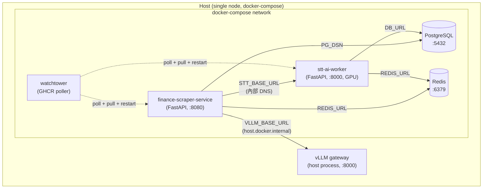

# ai-finance-infra

> 自架 AI 知識引擎的編排層 — 把 GitHub releases / arXiv / Podcast 等技術內容自動收進統一資料層,給後續 LLM 摘要與檢索使用。

這個 repo **本身不寫業務邏輯**,職責是用 `docker-compose` 把幾個獨立服務、共享的資料層、自動部署機制接在一起,跑在 home lab 上。

---

## 系統定位

整個系統由 3 個 repo 組成,各司其職:

| Repo | 角色 | 語言/技術 |
|---|---|---|
| **ai-finance-infra** (本 repo) | 編排層 — docker-compose、共享 PG/Redis、watchtower 自動部署、系統文件 (`docs/`) | Docker Compose / Quartz |
| [`finance-scraper-service`](https://github.com/pei9564/finance-scraper-service) | 從 GitHub releases / arXiv / HackerNews / RSS 收 AI infra 技術情報,vLLM 做中文摘要 | Python / FastAPI |
| [`stt-ai-worker`](https://github.com/pei9564/stt-ai-worker) | 語音內容 (Podcast / YouTube) 轉逐字稿,faster-whisper GPU 推論 | Python / FastAPI |

切成 3 個 repo 的理由:
- **執行特性差異** — scraper 是 IO 重(API + httpx + DB),stt 是 GPU 重(VRAM ~6GB),image 大小、scaling 策略、CI/CD 都不同
- **infra 是黏著層** — 改部署不用動業務 code,反之亦然
- **infra repo 同時當 hub** — `docs/` 放跨專案 narrative、ADR、拓樸圖,讀者進站先看這裡再選擇深入哪個 repo

---

## 元件拓樸



**關鍵設計選擇:**

- **PG / Redis 不貼 watchtower label** — 自動更新只動 scraper/stt 的 application image,stateful 服務手動升級
- **vLLM 跑在 host 而非 compose 內** — GPU 直通效率,且 vLLM 模型大,跨 service 重啟成本高;`host.docker.internal` 從容器連回 host
- **stt 與 scraper 互不依賴** — 兩條 ingestion pipeline 各自獨立,PG 是唯一交會點

---

## Port 對應

主機上同時有其他專案在跑,所有 port 都做了避讓:

| Service | 容器內 | Host | 避讓對象 |
|---|---|---|---|
| Redis | 6379 | **6380** | 其他專案佔的 6379 |
| PostgreSQL | 5432 | **5433** | 其他專案佔的 5432 |
| scraper | 8080 | **8080** (`SCRAPER_PORT` 可改) | — |
| stt | 8000 | **8001** | scraper 佔的 8000 |

---

## 部署

> 本系統 image 走私有 registry (目前 GHCR private,規劃遷移至自架 Harbor)。
> 完整跑起來需要 image pull credential。若只想檢視架構,看本檔 + `docker-compose.yml` + `docs/` 即可。

需要前置:
- Docker + Docker Compose v2
- (選用) NVIDIA Container Toolkit — 若 STT 走 `STT_DEVICE=cuda`
- 已 `docker login ghcr.io` (拉 private image 必要)

```bash
# 1. 設定環境變數 (整套系統的單一設定來源)
cp .env.example .env
# 編輯 .env: 至少要填 POSTGRES_PASSWORD 與 GITHUB_TOKEN

# 2. 登入 registry 拉 private image
echo $GHCR_PAT | docker login ghcr.io -u <username> --password-stdin

# 3. 起整套
docker compose up -d

# 4. 確認
docker compose ps
```

驗證點:
- `http://localhost:8080` — scraper UI / API
- `http://localhost:8080/docs` — scraper OpenAPI
- `http://localhost:8001` — STT UI
- `docker compose logs watchtower` — 30 秒 poll 一次 GHCR

## 本地開發

若同時 clone 了 `finance-scraper-service` / `stt-ai-worker` 到 sibling 路徑,
想 hot-edit scraper 的 YAML config 不 rebuild image,套上 dev override:

```bash
docker compose -f docker-compose.yml -f docker-compose.dev.yml up -d
```

dev override 做的事:
- mount `../finance-scraper-service/config:/app/config:ro` 覆寫 image 內建 yaml

純 image 部署 (production / try-it-out) 不要套這份,只跑 `docker-compose.yml` 即可。

---

## 自動部署 (watchtower)

scraper 與 stt 兩個 service 都貼了 `com.centurylinklabs.watchtower.enable=true` label。流程:

1. CI (兩個 application repo 各自的 GitHub Actions) build image → push `:latest` 到 GHCR
2. watchtower 每 30 秒問 GHCR 一次有沒有新 digest
3. 有 → `docker pull` → 重啟對應 container → 清舊 image

DB / Redis **沒貼 label**,不會被動;若想 pin 版本,把 `.env` 的 image tag 從 `:latest` 改成 `:sha-xxxxxxx`,watchtower 不會升 (因為 tag 不變)。

---

## 部署模式

| 階段 | 狀態 | 描述 |
|---|---|---|
| 單機 docker-compose | 🟢 Running | 目前在 dev 環境跑(本 repo) |
| 多節點 K3s on home lab | 🟡 Proposed | 4-node 家庭 lab,K3s manifests 預計放 `k8s/`,規劃中 |

K3s 部署完成後會把 manifests 與 GitOps 設定加進來,屆時 docker-compose 仍保留作為本地開發環境。

---

## 相關文件

完整架構決策記錄、ADR、跨專案 narrative 由 `docs/` 提供 (Quartz 站,透過 GitHub Pages 發佈)。原先位於獨立 repo [`ai-infra-portfolio`](https://github.com/pei9564/ai-infra-portfolio) 的內容正逐步遷入此處。
