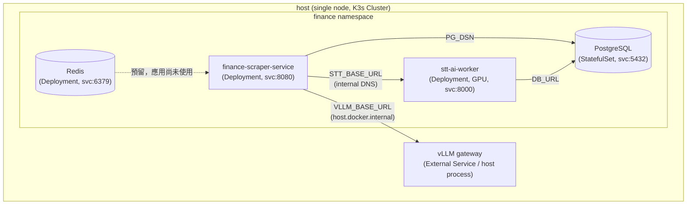

# ai-finance-infra

> Home lab 上跑的 AI 金融知識引擎 — 編排層。法說會 / podcast / YouTube 等金融多媒體 → STT → LLM 摘要 → 結構化資料層,所有架構決策都從硬體約束反推。

這個 repo **本身不寫業務邏輯**,職責是用 Kubernetes (K3s) 把幾個獨立服務、共享資料層接在一起,並當作整套系統的文件 hub。原有的 `docker-compose` 則退居本地開發與快速測試用。

<!-- 📖 **完整架構敘事、ADR、互動 demo:** [pei9564.github.io/ai-finance-infra](https://pei9564.github.io/ai-finance-infra/) -->

---

## 系統定位

3 個 repo 各司其職:

| Repo | 角色 | 語言/技術 |
|---|---|---|
| **ai-finance-infra** (本 repo) | 編排層 — docker-compose / K3s manifests、共享 PG/Redis、自動部署機制 | Docker Compose / K8s YAML |
| [`finance-scraper-service`](https://github.com/pei9564/finance-scraper-service) | 收外部來源 → 經 LLM gateway 翻譯/摘要 → 寫入 PG | Python / FastAPI |
| [`stt-ai-worker`](https://github.com/pei9564/stt-ai-worker) | 音訊轉逐字稿 (Podcast / YouTube),faster-whisper GPU 推論 | Python / FastAPI |

使用流程：`collect → 按需求 STT → 手動 translate / summarize`，收集時另產生跨來源日報摘要。scraper 是 IO 為主,STT 是 GPU 為主,scraper 透過 HTTP 提交 STT 任務並輪詢結果，PG 儲存事件、任務與逐字稿。Redis 目前未被應用使用，保留作為未來擴充。

切成 3 repo 的理由:
- **執行特性差異** — scraper IO 重 (API + httpx + DB),STT GPU 重 (VRAM ~6 GB),image 大小、scaling 策略、CI 都不同
- **infra 是黏著層** — 改部署不用動業務 code,反之亦然
- **infra repo 作為編排核心** — 集中管理架構設定與部署配置
<!-- - **infra repo 同時當 hub** — `docs/` 放跨專案 narrative、ADR、4 節點落位互動 demo,進站先看這裡再選擇深入哪個 repo -->

---

## 元件拓樸



關鍵設計選擇:
- **Compose 的 PG / Redis 不貼 watchtower label** — 自動更新只動 scraper/stt 的 application image,stateful 服務手動升級
- **vLLM 跑在 host 而非 compose 內** — GPU 直通效率較高、模型權重重啟成本大;`host.docker.internal` 從容器連回 host
- **scraper 透過 STT HTTP API 整合** — 提交任務後輪詢結果，STT 自己管理任務與逐字稿；scraper 將結果寫回事件正文
- **STT 任務持久化** — PG 保存來源描述；單一 worker 使用程序內佇列，重啟時從 PG 恢復未完成任務；上傳音檔保存於 volume / PVC

---

## Port 對應

主機同時跑其他專案,host port 全部避讓:

| Service | 容器內 | Host | 避讓對象 |
|---|---|---|---|
| Redis | 6379 | **6380** | 其他專案佔的 6379 |
| PostgreSQL | 5432 | **5433** | 其他專案佔的 5432 |
| scraper | 8080 | **8080** (`SCRAPER_PORT` 可改) | — |
| stt | 8000 | **8001** | scraper 佔的 8000 |

---

## 部署

> Image 目前置於 GHCR。完整跑起來需要相對應的環境變數與 credential；若只需了解架構，閱讀本 README 與 `docker-compose.yml` 即可。

前置:
- Docker + Docker Compose v2
- NVIDIA Container Toolkit (若 STT 走 `STT_DEVICE=cuda`)
- `docker login ghcr.io` (拉 private image 必要)

```bash
# 1. 設定環境變數 (整套系統的單一設定來源)
cp .env.example .env
# 至少要填 POSTGRES_PASSWORD 與 GITHUB_TOKEN

# 2. 登入 registry 拉 private image
echo $GHCR_PAT | docker login ghcr.io -u <username> --password-stdin

# 3. 起整套
docker compose up -d
docker compose ps
```

驗證點:
- `http://localhost:8080/docs` — scraper OpenAPI
- `http://localhost:8001` — STT UI
- `docker compose logs watchtower` — 30 秒 poll 一次 GHCR

### 本地開發 (sibling repo hot-edit)

同時 clone `finance-scraper-service` / `stt-ai-worker` 到 sibling 路徑時,套上 dev override 可以 mount scraper config 進去免 rebuild:

```bash
docker compose -f docker-compose.yml -f docker-compose.dev.yml up -d
```

純 image 部署 (production / try-it-out) 不要套這份。

---

## Compose 自動部署 (watchtower)

此機制只適用 Compose；K3s 不會由 watchtower 更新。K3s 更新請套用新 image tag 的 manifest，或在推送 `latest` 後執行 `kubectl rollout restart deployment/finance-scraper-service deployment/stt-ai-worker -n finance`。

scraper 與 stt 兩個 service 貼了 `com.centurylinklabs.watchtower.enable=true` label。流程:

1. 兩個 application repo 各自 CI build image → push `:latest` 到 GHCR
2. watchtower 每 30 秒問 GHCR 一次有沒有新 digest
3. 有 → `docker pull` → 重啟對應 container → 清舊 image

DB / Redis **沒貼 label**,不會被動;要 pin 版本就把 `.env` 的 image tag 從 `:latest` 改成 `:sha-xxxxxxx`,watchtower 不會升 (因為 tag 不變)。

---

## 部署演進

| 階段 | 狀態 | 描述 |
|---|---|---|
| 單節點 K3s | 🟢 Running | **目前的正式運行環境**，資源控管與 GPU 分配更精準 |
| 單機 docker-compose | 🟡 Dev-only | 退役並轉為本地開發用，保留 `docker-compose.yml` |
| 多節點 K3s on home lab | ⚪ Planned | 其餘節點就緒後以 `k3s agent` 加入叢集 |

### K3s 部署 (單節點)

> **完整教學與踩坑紀錄請參考：[docs/k3s-setup-draft.md](docs/k3s-setup-draft.md)**

```bash
# 1. 安裝 K3s
curl -sfL https://get.k3s.io | sh -

# 2. 安裝 NVIDIA device plugin (GPU 節點需要)
sudo k3s kubectl apply -f https://raw.githubusercontent.com/NVIDIA/k8s-device-plugin/v0.17.0/deployments/static/nvidia-device-plugin.yml

# 3. 建立 namespace + secrets
sudo k3s kubectl apply -f k8s/namespace.yaml
cp k8s/secrets.yaml.example k8s/secrets.yaml   # 填入真實值
sudo k3s kubectl apply -f k8s/secrets.yaml
sudo k3s kubectl create secret docker-registry ghcr-cred \
  --docker-server=ghcr.io --docker-username=pei9564 \
  --docker-password=<GHCR_PAT> -n finance

# 4. 部署基礎設施
sudo k3s kubectl apply -f k8s/postgres.yaml
sudo k3s kubectl apply -f k8s/redis.yaml
sudo k3s kubectl apply -f k8s/vllm-external.yaml   # 記得改 Host IP

# 5. (可選) 從 Docker Compose 遷移 PG 資料
docker compose exec postgres pg_dump -U admin -d finance_db -Fc -f /tmp/dump.sql
docker compose cp postgres:/tmp/dump.sql ./finance_db.dump
sudo k3s kubectl wait --for=condition=ready pod -l app=postgres -n finance --timeout=60s
sudo k3s kubectl cp ./finance_db.dump finance/postgres-0:/tmp/dump.sql
sudo k3s kubectl exec -n finance postgres-0 -- pg_restore -U admin -d finance_db --clean --if-exists /tmp/dump.sql

# 6. 部署應用
sudo k3s kubectl apply -f k8s/scraper.yaml
sudo k3s kubectl apply -f k8s/stt.yaml

# 7. 驗證
sudo k3s kubectl get pods -n finance

# 8. Port forward 測試
sudo k3s kubectl port-forward svc/finance-scraper-service 8080:8080 -n finance
sudo k3s kubectl port-forward svc/stt-ai-worker 8001:8000 -n finance
```

K3s 落地後 docker-compose 仍保留作為本地開發環境。

---

<!-- 
## 文件

`docs/` 是純靜態 HTML/CSS/JS,GitHub Pages 直接從 `docs/` 部署,無 build step:

| 入口 | 內容 |
|---|---|
| [Landing](https://pei9564.github.io/ai-finance-infra/) | 硬體基線 + 系統架構圖 + ADR 卡片 |
| [Build log](https://pei9564.github.io/ai-finance-infra/viewer.html?file=build-log.md) | 每天工程決策日誌 |
| [ADR-001 · 4 節點落位](https://pei9564.github.io/ai-finance-infra/demos/four-node-topology.html) | 互動 demo (docker-compose ↔ K3s 切換) |
| [ADR-005 · 本地推論 runtime 選型](https://pei9564.github.io/ai-finance-infra/demos/serving-runtime-decision.html) | 互動 demo (vLLM vs Ollama vs llama.cpp) |

原 [`ai-infra-portfolio`](https://github.com/pei9564/ai-infra-portfolio) (Quartz 站) 已退役,內容遷至本 repo `docs/`。
-->

## 健康檢查與任務恢復

兩個服務皆提供 `/healthz` 與 `/readyz`。scraper readiness 檢查 PostgreSQL；STT liveness 檢查 worker thread，readiness 另外檢查 PG。STT startup probe 最多等待 30 分鐘讓模型載入。

STT 仍限定單一 replica、單一 uvicorn process；PG 任務恢復不是多 worker 分散式佇列。重啟後 queued / running 任務從頭重新執行，並非從音訊中斷點繼續。舊版沒有來源描述的任務會標為 error，需重新提交。

上傳檔案掛載 `/data/uploads`（Compose named volume、K3s `stt-uploads` PVC）。失敗及取消任務保留音檔供手動重試；成功或刪除任務後清理。K3s local-path PVC 依賴原節點磁碟，不能保證節點故障後跨節點恢復。

失敗任務可從 STT UI 按「重試」，或呼叫 `POST /job/{job_id}/retry`。已完成或執行中的任務不能重試。

## 瀏覽器端到端測試

[Playwright E2E](e2e/README.md) 會啟動隔離 PostgreSQL、scraper 與 STT，驗證上傳、任務重試、取消、重啟恢復，以及影音轉錄到摘要與收藏的完整 UI 流程。測試無需 GPU 或外部服務 credential，失敗時保留 trace、截圖與影片；GitHub Actions workflow 為 `.github/workflows/e2e.yml`。
